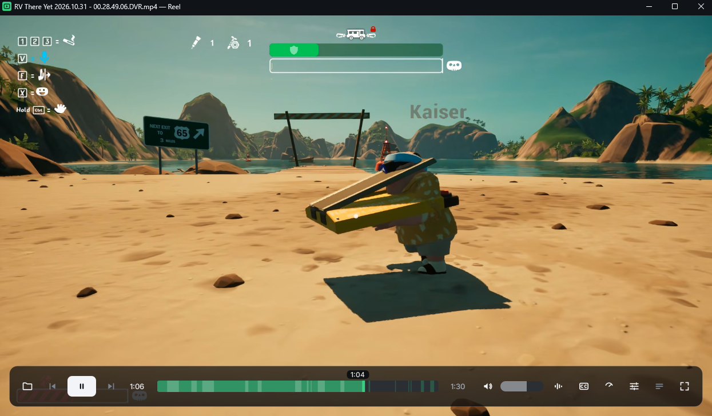

<div align="center">
  
</div>

<h1 align="center">Reel</h1>

<p align="center">
  <b>Plays what VLC plays. Looks nothing like it.</b><br>
  A single-file video player for Windows. The video fills the window, the
  controls fade over it, and nothing else is on screen.
</p>

<p align="center">
  <a href="https://github.com/sabari50312/Reel"></a>
  
  
  
  
  
</p>

<p align="center">
  <a href="docs/preview.png"></a>
</p>

## Why Reel

VLC plays everything and looks like 2008. Reel keeps the decoder that opens
whatever you throw at it and draws a new interface around it.

mkv, mp4, webm, HEVC, AV1, 10-bit, several audio and subtitle tracks: libVLC
decodes them and paints straight into the window, so seeking stays instant and a
4K file does not make the controls lag. The UI is drawn entirely in code, with
vector icons and a painted seek bar. No image assets, no QML layer.

## Features

- Hardware-decoded video into a native surface, so frames never make a round trip
  through the CPU.
- The controls fade in when you move the mouse and leave again when you stop.
  Seek bar, hover preview, volume, speed, fullscreen, nothing else.
- A loudness map of the file drawn under the seek bar, so you can see where it
  gets quiet or loud before you scrub there.
- Subtitle delay nudged live, a sync strip that plots the caption cues against
  that loudness map, and styling that applies without reopening the file.
- OpenSubtitles search, hash matched to the file, with your own API key.
- File browser with quick places, drives, history and a path bar you click to
  edit.
- Per-file resume, single instance, drag and drop, portable mode, dark title
  bar.
- Opt-in *Open with* registration for 13 video and 9 audio formats, per user,
  never taking over the default.

## Install

Release builds are portable: unzip and run. No installer, no admin rights, no
services.

1. Download `Reel-<version>-win64.zip` (about 121 MB) from
   [Releases](https://github.com/sabari50312/Reel/releases).
2. Unzip it wherever you like, a folder of your own, a USB stick, `C:\Tools\Reel`.
3. Run `Reel.exe`.

Unzipped it comes to around 293 MB, mostly the bundled VLC that keeps the player
self-contained. Deleting the folder uninstalls it.

SmartScreen warns about the unsigned exe on first run. Choose **More info**, then
**Run anyway**.

## Run from source

You need Windows 10/11 x64, Python 3.12, [uv](https://docs.astral.sh/uv/) and a
64-bit VLC 3 install. Release builds carry their own VLC, so this is only for
source checkouts.

```powershell
uv sync
uv run python main.py "C:\path\to\video.mkv"
```

The path is optional. Reel looks for `libvlc.dll` in a `vlc\` folder next to the
executable, then a project-local `vlc\`, then in `C:\Program Files\VideoLAN\VLC`.
Set `REEL_VLC_DIR` to use another installation.

## Build

```powershell
uv run python tools/build.py
```

Nuitka compiles the app, then the script copies VLC and the licence texts into
`dist\Reel\`, adds the portable marker and writes
`dist\Reel-<version>-win64.zip`. VLC has to be installed on the build machine.

| Flag | Effect |
| --- | --- |
| `--skip-nuitka` | Repackage an existing build instead of compiling again |
| `--no-zip` | Skip the archive, leave the folder in `dist\Reel\` |

## Keyboard

These are the defaults. To change one, open **Settings → Keybindings**, click the
action and press the keys you want. Hold a key to repeat volume, speed, subtitle
delay and audio delay steps.

| Action | Default keys |
| --- | --- |
| Play / pause | `Space` or `K` |
| Back / forward 5 s | `←` / `→` |
| Back / forward 30 s | `Shift`+`←` / `Shift`+`→` |
| Back / forward 10 s | `J` / `L` |
| Volume down / up | `↓` / `↑` |
| Mute | `M` |
| Speed down / up / normal | `[` / `]` / `=` |
| Subtitle delay later / earlier / reset | `Z` / `X` / `Shift`+`Z` |
| Audio delay later / earlier / reset | `.` / `,` / `Shift`+`.` |
| Next audio / subtitle track | `B` / `V` |
| Search subtitles online | `Ctrl`+`Shift`+`S` |
| Fullscreen / leave fullscreen | `F` / `Esc` |
| Open file | `Ctrl`+`O` |
| Settings / search settings | `Ctrl`+`P` / `Ctrl`+`F` |
| Quit | `Ctrl`+`Q` |

Click the picture to play or pause, double-click it for fullscreen, and move the
mouse to bring the controls back. The wheel changes volume, or seeks if you
change `input.wheel`.

## Settings

Settings are per user, in `%APPDATA%\Reel\settings.ini`. Portable builds keep a
`reel.ini` next to the executable instead, because the build drops a
`reel.portable` marker there.

Most of the player is configurable from the Settings window: how long the overlay
stays up (`ui.overlay_delay_ms`, 2600 ms by default), what the wheel does over
the picture (`input.wheel`: volume, seek, ignore), what a click and a double
click do, always on top, and every key binding. Unhandled errors are appended to
`%LOCALAPPDATA%\Reel\reel.log`.

## Formats

Playback goes through libVLC, so anything it opens will play. These are the
formats Reel can also register for in *Open with*, per user, without touching
your default player.

<details>
<summary><b>13 video and 9 audio formats</b></summary>

- **Video:** mkv, mp4, m4v, mov, avi, wmv, webm, mpg, mpeg, ts, m2ts, flv, ogv
- **Audio:** mp3, m4a, aac, flac, wav, ogg, opus, wma, mka

</details>

## How it is built

libVLC paints into a native child window inside the Qt window, and Windows
composites native children above anything Qt draws in that window. A widget
placed over the video would therefore be invisible, so the controls live in a
separate frameless, translucent, always-on-top window that tracks the client rect
of the player. VLC's own Qt frontend solves it the same way.

Playback time is polled at about 30 Hz instead of taking libVLC's coarse time
events, and only `reel/engine.py` imports `vlc`. Everything above it is Qt
signals.

## Limitations

- Windows only. The video embedding path has no Linux or macOS equivalent.
- No installer. Unzip and run; deleting the folder uninstalls it.
- One file at a time. No playlist, no library, no codec picker.
- The builds are unsigned, so SmartScreen warns on first run.
- Online subtitles need a free OpenSubtitles API key.

## Licence

MIT, see [`LICENSE`](LICENSE). The build also contains libVLC (LGPL-2.1), Qt and
PySide6 (LGPL-3.0), FFmpeg (LGPL-2.1) and the Inter and Sora typefaces
(OFL-1.1). See [`THIRD-PARTY.md`](THIRD-PARTY.md) for the details and the
bundled licence texts.

<p align="center">
  <sub>Windows. Drawn in code. No image assets.</sub>
</p>
